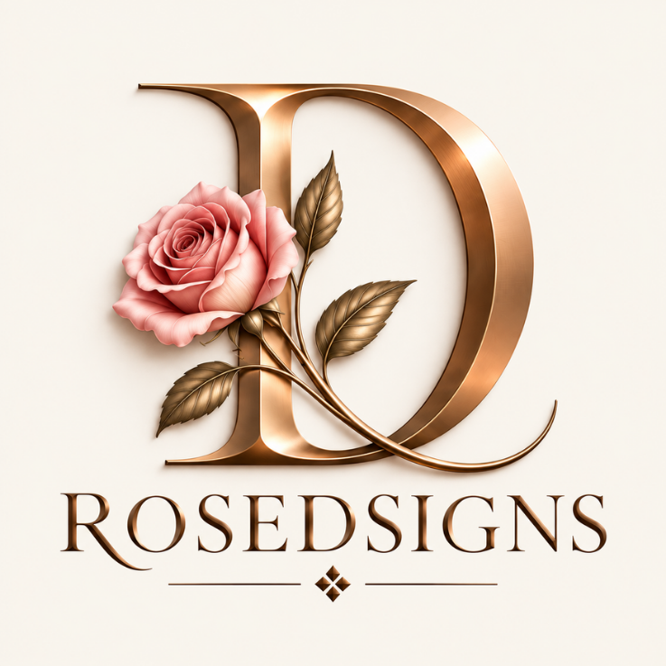

# RoseDsigns – Creative Design & Digital Marketing Agency Website

\<p align="center">
&#x20; \
\</p>

\<p align="center">
&#x20; \*\*Ideas that make your brand bloom.\*\*
\</p>

\<p align="center">
&#x20; A responsive, multi-page creative agency website built with React, TypeScript and Vite.
\</p>

\<p align="center">
&#x20; [Live Website]\([https://rosedsigns-website.vercel.app/](https://rosedsigns-website.vercel.app/)) · [GitHub Repository]\([https://github.com/Ams1421/Rosedsigns-website](https://github.com/Ams1421/Rosedsigns-website))
\</p>

---

## 1. Project Overview

RoseDsigns is a multi-page creative agency website developed to present a creative design and digital marketing brand. The website introduces the agency, highlights its services, showcases portfolio concepts, explains its creative process and provides contact options for potential clients.

The project focuses on modern visual design, responsive layouts, smooth navigation and an engaging user experience across desktop and mobile devices.

## 2. Project Details

| Field                   | Description                                                                                    |
| ----------------------- | ---------------------------------------------------------------------------------------------- |
| Project Name            | RoseDsigns Website                                                                             |
| Project Type            | Responsive Multi-Page Website                                                                  |
| Industry                | Creative Design & Digital Marketing                                                            |
| Application             | React + TypeScript + Vite                                                                      |
| Routing                 | React Router DOM                                                                               |
| Styling                 | CSS3                                                                                           |
| Icons                   | Lucide React                                                                                   |
| Development Environment | Visual Studio Code                                                                             |
| Version Control         | Git & GitHub                                                                                   |
| Hosting Platform        | Vercel                                                                                         |
| Deployment Branch       | main                                                                                           |
| Build Output            | dist                                                                                           |
| Live Website            | [https://rosedsigns-website.vercel.app/](https://rosedsigns-website.vercel.app/)               |
| GitHub Repository       | [https://github.com/Ams1421/Rosedsigns-website](https://github.com/Ams1421/Rosedsigns-website) |

## 3. Project Objectives

- Establish a professional digital identity for RoseDsigns.
- Present creative and digital marketing services.
- Showcase illustrative portfolio concepts.
- Explain the agency's project workflow.
- Provide clear navigation and enquiry options.
- Deliver a responsive experience across different screen sizes.

## 4. Technology Stack

| Technology       | Purpose                                 |
| ---------------- | --------------------------------------- |
| React            | Component-based user interface          |
| TypeScript       | Type-safe application development       |
| Vite             | Development server and production build |
| React Router DOM | Multi-page navigation                   |
| HTML5            | Website structure                       |
| CSS3             | Styling, layouts and responsive design  |
| Lucide React     | Interface icons                         |
| Git              | Version control                         |
| GitHub           | Source code hosting                     |
| Vercel           | Website deployment                      |

**Note:** Exact installed package versions are maintained in `package.json` and `package-lock.json`.

## 5. Website Pages

| Page         | Route           | Description                                        |
| ------------ | --------------- | -------------------------------------------------- |
| Home         | `/`             | Brand introduction, featured work and key sections |
| About        | `/about`        | Brand identity, philosophy and values              |
| Services     | `/services`     | Creative and digital service offerings             |
| Work         | `/work`         | Portfolio concept collection and category filters  |
| Process      | `/process`      | Four-stage creative workflow                       |
| Testimonials | `/testimonials` | Client experience and creative philosophy          |
| Contact      | `/contact`      | Project enquiry form and contact information       |
| 404 Page     | `*`             | Invalid route handling                             |

## 6. Key Features

- Responsive desktop and mobile layouts.
- Consistent shared header and footer.
- Multi-page navigation using React Router DOM.
- Interactive navigation and call-to-action buttons.
- Portfolio project cards and category filtering.
- Local image assets for website visuals.
- Service presentation sections.
- Four-stage project process presentation.
- Contact enquiry form with pre-filled email functionality.
- Custom visual identity and typography.
- Vercel deployment with route rewriting for direct page access.

## 7. Design and Visual Identity

The website follows a dark luxury-inspired visual style.

| Design Element     | Description                                      |
| ------------------ | ------------------------------------------------ |
| Primary Background | Deep dark and burgundy tones                     |
| Accent Colour      | Rose pink                                        |
| Secondary Accent   | Warm gold                                        |
| Typography         | Elegant serif headings and clean body text       |
| Imagery            | Locally stored brand and project visuals         |
| Layout             | Modern cards, grids and editorial-style sections |

## 8. Project Assets

The website uses locally stored image assets from the `public/images/` directory.

| Asset                           | Purpose                   |
| ------------------------------- | ------------------------- |
| `rosedsigns-logo.png`           | Brand logo                |
| `hero-yellow-flowers.jpg`       | Homepage hero visual      |
| `rosedsigns-about.jpg`          | About page visual         |
| `services-studio.jpg`           | Services page visual      |
| `work-01-website.jpg`           | Website design concept    |
| `work-02-brand-identity.jpg`    | Branding concept          |
| `work-03-social-campaign.jpg`   | Social media concept      |
| `work-04-marketing.jpg`         | Marketing concept         |
| `work-05-packaging.jpg`         | Packaging concept         |
| `work-06-ecommerce.jpg`         | E-commerce concept        |
| `work-07-cafe-identity.jpg`     | Café branding concept     |
| `work-08-fashion-campaign.jpg`  | Fashion campaign concept  |
| `work-09-portfolio-website.jpg` | Portfolio website concept |

Additional images are included for contact, process and client experience sections.

## 9. Project Structure

```text
RoseDsigns-Landing-Page/
│
├── public/
│   └── images/
│       ├── rosedsigns-logo.png
│       ├── hero-yellow-flowers.jpg
│       ├── rosedsigns-about.jpg
│       ├── services-studio.jpg
│       ├── work-01-website.jpg
│       └── ...
│
├── src/
│   ├── components/
│   │   ├── Header.tsx
│   │   ├── Footer.tsx
│   │   └── Layout.tsx
│   │
│   ├── pages/
│   │   ├── Home.tsx
│   │   ├── About.tsx
│   │   ├── Services.tsx
│   │   ├── Work.tsx
│   │   ├── Process.tsx
│   │   ├── Testimonials.tsx
│   │   └── Contact.tsx
│   │
│   ├── App.tsx
│   └── ...
│
├── index.html
├── package.json
├── package-lock.json
├── tsconfig.json
├── vite.config.ts
├── vercel.json
├── .gitignore
└── README.md
```

*The structure above highlights the main project files; additional CSS, configuration and supporting files are also included.*

## 10. Installation and Local Setup

### Prerequisites

- Node.js
- npm
- Git
- Visual Studio Code or another code editor

### Clone the repository

```bash
git clone https://github.com/Ams1421/Rosedsigns-website.git
```

### Navigate to the project

```bash
cd Rosedsigns-website
```

### Install dependencies

```bash
npm install
```

### Start the development server

```bash
npm run dev
```

Open the local URL displayed in the terminal, usually:

```text
http://localhost:5173/
```

## 11. Production Build

To create an optimized production build:

```bash
npm run build
```

The production files are generated in:

```text
dist/
```

To test the production build locally:

```bash
npm run preview
```

## 12. Deployment

The project is hosted on Vercel and connected to its GitHub repository.

| Deployment Detail     | Value           |
| --------------------- | --------------- |
| Hosting Platform      | Vercel          |
| Source Repository     | GitHub          |
| Production Branch     | main            |
| Build Command         | `npm run build` |
| Output Directory      | `dist`          |
| Routing Configuration | `vercel.json`   |

The Vercel configuration supports direct navigation to application routes.

## 13. Important Project Notes

- The nine portfolio entries are illustrative creative concepts and should not be represented as verified client projects.
- The contact form opens the visitor's email application with a pre-filled enquiry; it does not send messages through a backend service.
- The reviewed implementation does not include a database-backed content management system.
- The website uses local image assets for its visual content.

## 14. Future Enhancements

- Backend-powered contact form submission.
- Database integration for enquiry management.
- Content management system for portfolio updates.
- Search engine optimization improvements.
- Website analytics and performance monitoring.
- Additional accessibility improvements.

## 15. Project Links

**Live Website:**
[https://rosedsigns-website.vercel.app/](https://rosedsigns-website.vercel.app/)

**GitHub Repository:**
[https://github.com/Ams1421/Rosedsigns-website](https://github.com/Ams1421/Rosedsigns-website)

---

## Conclusion

RoseDsigns demonstrates the development of a modern, responsive creative agency website using React, TypeScript and Vite. It combines brand presentation, service information, portfolio concepts, navigation and contact functionality in a cohesive multi-page experience.

The project showcases practical skills in frontend development, responsive web design, component-based architecture, version control and production deployment.

\<p align="center">   \*\*RoseDsigns – Ideas that make your brand bloom.\*\* \</p>
